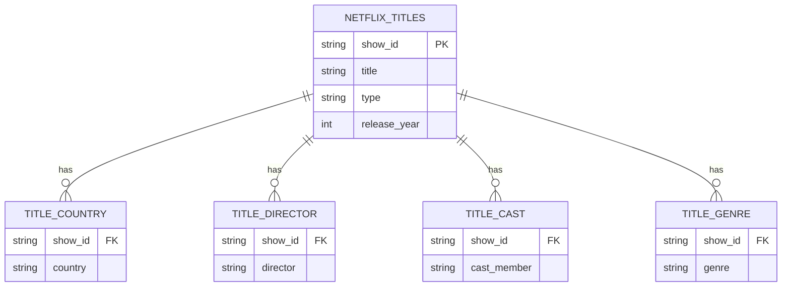
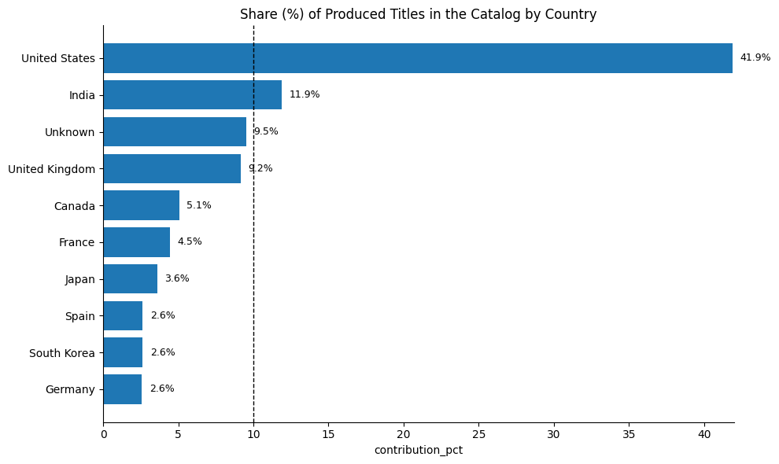
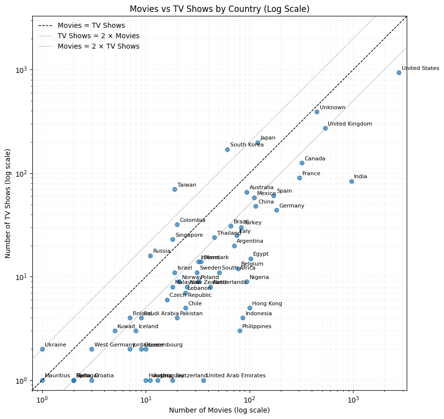

# Netflix Catalog Analysis (SQL)
### Is our shrinking attention span reshaping Netflix's content strategy?

## Overview

SQL-based analysis of Netflix's content catalog, exploring how the platform's production strategy has evolved over time, including a focus on the balance between TV shows (short episodes) and movies (longer format).

The analysis is framed around a broader hypothesis: as audience attention spans shrink, streaming platforms may be adapting their catalogs toward shorter, more fragmented content.

<!--
Add reference to some findings to illustrate also the conclusion of the study
Evaluate to add an image also, to put on the side of the overview as in the readme of the profile
-->

 

## Database and Assumptions

<!-- 
- [Link](https://www.kaggle.com/datasets/shivamb/netflix-shows) e provenienza dataset da Kaggle
- "No real time data"
- data about catalog and not effective viewership, the analysis reflects only Netflix offering, but assumes such can be in response to shifts in consumers behaviors
- when comparing the trend of duration individually by Type (Movies and TV Shows), only Movies are accounted for: as for TV Shows, at first Season is not an objective measure of duration for the analysis in object, then, even surpassing this ambiguity, there are no indication regarding the fact that a TV Show in the catalog is ended or in progress, therefore the number of Season metric being unreliable
-->

The dataset is sourced from [Kaggle – Netflix Movies and TV Shows](https://www.kaggle.com/datasets/shivamb/netflix-shows)
and represents a static snapshot, not real-time data.

- **Catalog, not consumption**: the data describes Netflix's *offering*, not
  actual viewership. The analysis assumes that catalog composition can
  reflect shifts in consumer behavior, without claiming a causal relationship.
- **Duration trend limited to Movies**: when comparing content duration over
  time, only Movies are included. TV Shows are excluded from this specific
  analysis for two reasons: season count is not an objective proxy for
  duration (episode count and length vary widely across shows), and the
  dataset provides no indication of whether a show is completed or still
  ongoing (making season count unreliable even setting the first issue aside).

## Database Inspection and Schema Redesign

<!-- 
- 8807 titles
- difference between release year and date_added (to catalog)
- time interval (date_added): 2014-2021
- duration: minutes for Movies, Seasons for TV Shows
- lists of items in the same cell for director, cast, country, listed_in: hard to apply counting operators
-->

The original dataset consists of **8,807 titles**, with `date_added`
(the date a title entered the catalog) ranging from **2014 to 2021** —
distinct from `release_year`, which can inflate it significantly.
`duration` is recorded in minutes for Movies and in seasons for TV Shows,
requiring separate handling of the two content types throughout the analysis.

The main structural issue, however, is that several variables — `director`,
`cast`, `country` and `listed_in` — store **multiple items within a single
cell**. This prevents reliable use of aggregate functions (e.g. `COUNT`) and
called for a re-modeling of the database.

The adopted solution uses Python to **split each of these variables into a
dedicated supporting table**, duplicating rows by `show_id` for every
additional item found. Each supporting table is keyed back to the original
database via `show_id`: this keeps the core dataset lean and computation-friendly,
while `show_id` (efficient for joins but uninformative on its own) is
paired in the supporting tables with attributes like `title`, needed to make
results interpretable. An example of the new relational scheme is given here:

## Key Challenges

- **Different units for `duration` field for Movies and TV Shows impose the structuring of a different analysis for the two subgroups.**
- **Missing values in `country` accounting for ~9.5% of the titles and handling as a separate category**
- **Multi-value attributes stored in single cells and the consequent need normalization**

## Analysis

### Content production across countries

*Note: titles with a missing `country` value were checked individually to detect potential patterns (e.g. by genre) before deciding how to treat them. No meaningful pattern emerged — the missing values appear heterogeneous — so these titles were retained in the total count when computing Movies/TV Shows percentages by country and included in the `country` value Unknown.*

Ranking countries by number of titles produced reveals a strongly concentrated catalog: the **United States** and **India** are the only countries to exceed the threshold of **10% share** of total titles, while all other producers trail well behind.

  

| country        | num_titles | contribution_pct |
|----------------|--------|---------|
| United States  | 3690   | 41.90   |
| India          | 1046   | 11.88   |
| Unknown        | 838    | 9.52    |
| United Kingdom | 806    | 9.15    |
| Canada         | 445    | 5.05    |
| France         | 393    | 4.46    |
| Japan          | 318    | 3.61    |
| Spain          | 232    | 2.63    |
| South Korea    | 231    | 2.62    |
| Germany        | 226    | 2.57    |

<em>Top 10 countries by percentage contribution to catalog production</em>

It is worth noting that the choice of reporting extensively only the top 10 countries by total title production - for the part of the analysis that comes further, too - stems from the fact that their volume allows to interpret more consistently their Movies and TV Shows production and consequently the percentage of Movies metric. Complementarily, the log-scale scatterplot including all countries is offered to provide a more global point of view, even if as production volume decreases the values are more unreliable.

Beyond volume, the balance between Movies and TV Shows varies significantly across these countries. Comparing each country's Movie output against its TV Show output highlights a distinct group of **TV-heavy producers**: Japan, South Korea stand out with a markedly low share of movies relative to TV shows — consistent with strong domestic TV/drama and anime industries — alongside a handful of countries showing the same pattern on a much smaller production volume and therefore less statistically meaningful.

Conversely, the United States, India and other countries not present in the top 10 by total titles produced (e.g. Hong Kong, Indonesia, Philippines and United Arab Emirates) prove to be more **Movie-heavy producers**.

ADD PERCENTAGES AND DATA referred to the table!

  

<table>
<tr>
<th>country</th>
<th>movies</th>
<th>tv_shows</th>
<th>total_titles</th>
<th>pct_movies</th>
</tr>
<tr><td>United States</td><td>2752</td><td>938</td><td>3690</td><td>74.58</td></tr>
<tr><td>India</td><td>962</td><td>84</td><td>1046</td><td>91.97</td></tr>
<tr><td>Unknown</td><td>446</td><td>392</td><td>838</td><td>53.22</td></tr>
<tr><td>United Kingdom</td><td>534</td><td>272</td><td>806</td><td>66.25</td></tr>
<tr><td>Canada</td><td>319</td><td>126</td><td>445</td><td>71.69</td></tr>
<tr><td>France</td><td>303</td><td>90</td><td>393</td><td>77.10</td></tr>
<tr><td>Japan</td><td>119</td><td>199</td><td>318</td><td>37.42</td></tr>
<tr><td>Spain</td><td>171</td><td>61</td><td>232</td><td>73.71</td></tr>
<tr><td>South Korea</td><td>61</td><td>170</td><td>231</td><td>26.41</td></tr>
<tr><td>Germany</td><td>182</td><td>44</td><td>226</td><td>80.53</td></tr>
</table>

<em>Movies vs TV Shows production by country (Top 10 by total titles)</em>

An interesting point emerging from this breakdown is that the Movies/TV Shows mix seems to reflect mostly the structure of the local industries (e.g. Asian countries and anime/shows culture). This factor can plausibly be taken into account in the analysis, differentiating geographical preferences from behavioral ones like attention span, which is the subject of this analysis.

An interesting point emerging from this breakdown is that the Movies/TV Shows mix plausibly reflects the structure of local industries (e.g. anime and drama production in Japan and South Korea) rather than viewers' preferences alone. This matters for the analysis that follows: a shift in the geographic composition of the catalog could alter the aggregate mix over time even with no change in attention-related behavior (a composition effect). Since the temporal analysis is run on the aggregate catalog, this effect is not controlled for and is acknowledged as a limitation (see Limitations & Next Steps).

### Evolution of short vs. long contents

first point: declare how to distinguish the analysis for tv shows and movies

second point: tv-shows and movies - absolute and relative evolution year by year in the catalog expansion

third point: movies specific for the different granularity - study the average duration year by year

let's go, not so hard!!!!

## Key Findings

## Limitations and Next Steps

## Point 2 - Temporal evolution of short vs long contents
There are several studies that indicates how with years passing and evolution of the pace of life, digitalization and social media the attention threshold of people has decreased.

- Interesting to inspect if the production release schedule of Netflix over years is coherent with such a trend, and in general understand if one type of content is preferred/more easily produced and so on (# of movies and TV shows for release year, or #titles released each year (absolute) + % movies over the total to be more synthetic)

- Focusing on Movies only (assumptions that you do not know if the number of seasons of a TV shows is ended or in process, so not reliable measure of duration), repeat the analysis by finding for each year aggregated measures related to duration

  
